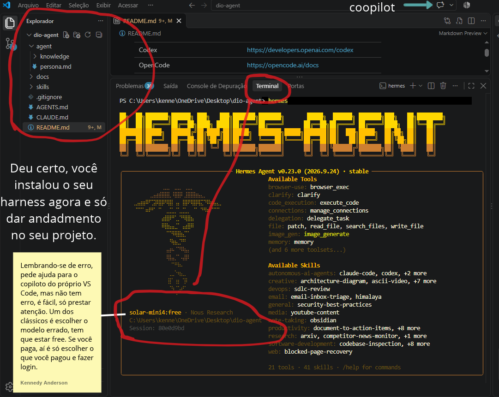
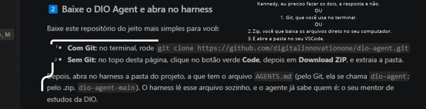
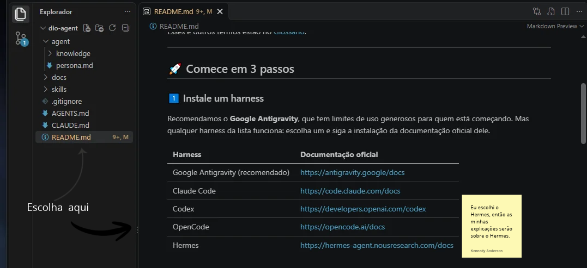
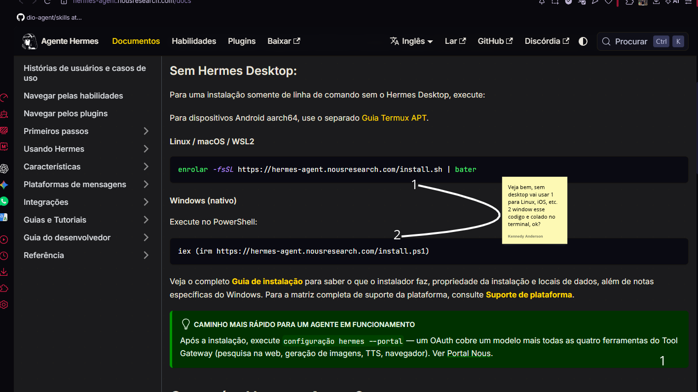
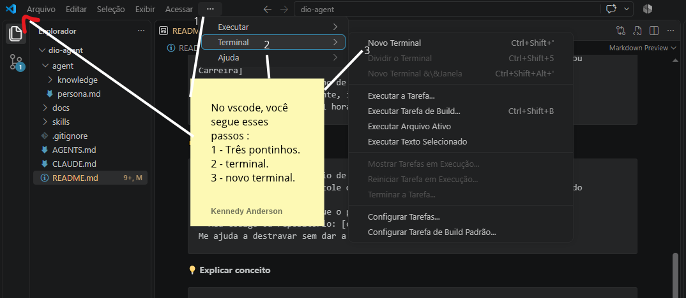
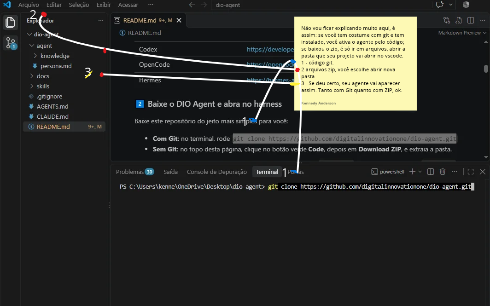
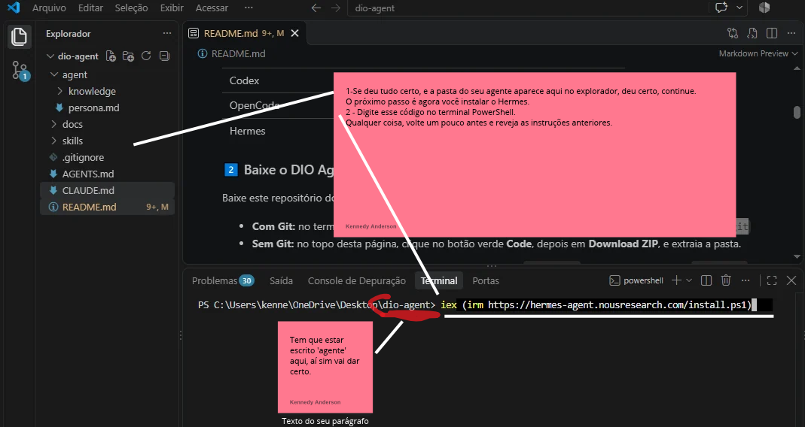
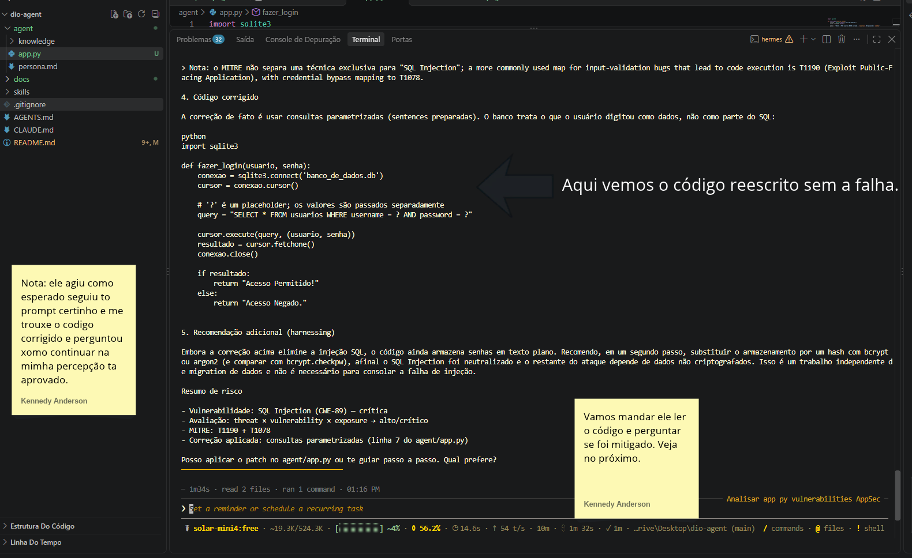
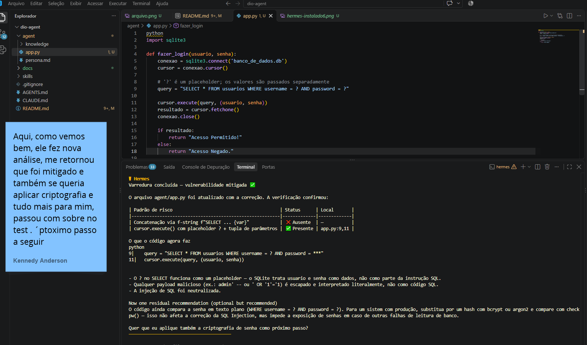
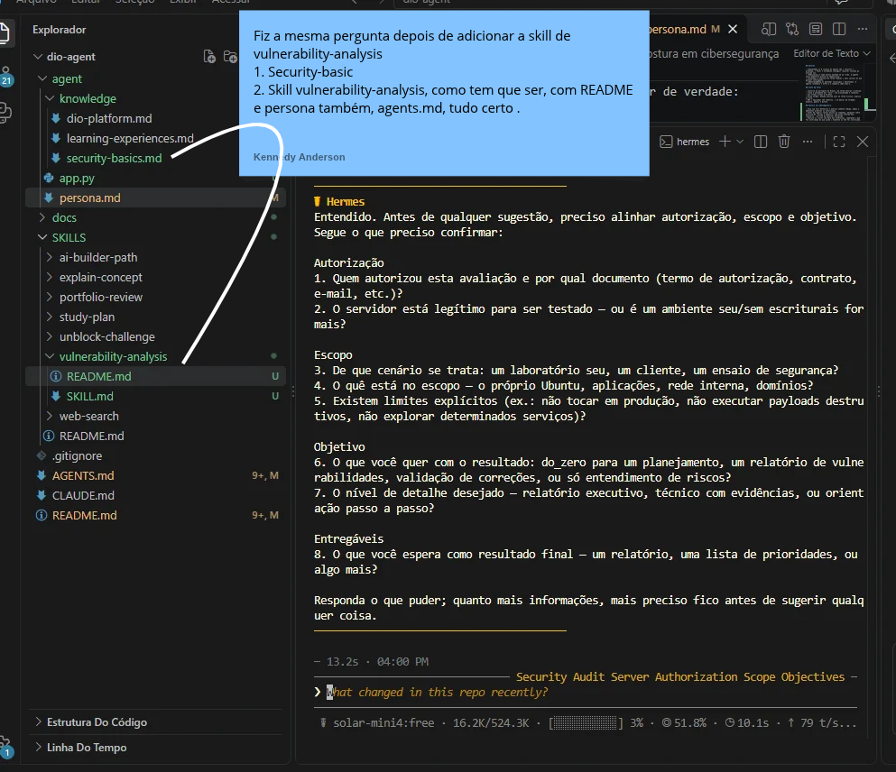

# 🤖 DIO Agent 

> Seu mentor com Inteligência Artificial para aprender mais e melhor na [DIO](https://dio.me).

O **DIO Agent** é um agente de IA que acompanha você na sua jornada de estudos. Ele conhece as experiências da DIO (Bootcamps, Formações, Cursos, Desafios e muito mais) e ajuda você a estudar, praticar e planejar a sua carreira.

Você não precisa saber programar nem instalar nada complicado. Em **3 passos**, o seu mentor está pronto para usar.

---

## ✨ Três palavras para começar

- 🧠 **Agente de IA:** um chatbot responde perguntas. Um *agente* vai além: lê, planeja e executa passos para ajudar você a alcançar um objetivo. É a diferença entre alguém que explica o caminho e alguém que caminha junto com você.
- 🖥️ **Harness:** é o programa onde o agente roda. O agente é o mentor, e o harness é a sala onde vocês se encontram. O mesmo mentor atende em salas diferentes, por isso o DIO Agent funciona em vários harnesses.
- 🧩 **Skill:** é uma habilidade do agente, descrita em um guia passo a passo. Você não precisa chamar a skill: o agente percebe o que você precisa e usa a certa sozinho.

Esses e outros termos estão no [Glossário](docs/glossary.md).

---

## Projeto DIO do Bootcamp Cybersegurança do Santander

### Autor: Kennedy Anderson
### Instrutora: Isadora Ferrão
### Ano: 2026

A partir dessa base, desenvolvi uma adaptação com foco em cibersegurança defensiva como projeto do Bootcamp de Cibersegurança do Santander.

**Autor da adaptação:** Kennedy Anderson

---

## Sobre o projeto

Este projeto evolui o DIO Agent para atuar como um mentor de cibersegurança, com foco em análise defensiva de vulnerabilidades. A proposta é que o agente não sugira ações automaticamente: primeiro, ele deve entender o contexto e confirmar que a análise acontece em um ambiente autorizado e controlado; depois, deve explicar os riscos e orientar possíveis correções.

A especialização foi criada com arquivos de instrução e conhecimento, sem treinar um modelo. O projeto inclui:

- a skill de análise defensiva em `skills/vulnerability-analysis/`, com `SKILL.md` para orientar o agente e `README.md` para explicar a skill;
- fundamentos de segurança em `agent/knowledge/security-basics.md`, incluindo vulnerabilidade, ameaça, risco, tríade CID e boas práticas;
- orientações de segurança em `agent/persona.md` e registro da skill e do conhecimento no `AGENTS.md`;
- um exemplo de login em `agent/app.py`, corrigido para usar consulta parametrizada contra SQL Injection.

Também testei o Hermes com um cenário hipotético de servidor Ubuntu. Antes de sugerir comandos, ele perguntou sobre autorização, escopo, objetivo e limites da análise. Os testes foram limitados a código de laboratório e cenários hipotéticos.

### O que este projeto pretende demonstrar

- como especializar um agente usando skills, arquivos de conhecimento e instruções;
- como conduzir uma análise de segurança com contexto e autorização;
- como identificar, corrigir e validar uma vulnerabilidade em um exemplo controlado;
- como documentar o processo e as decisões tomadas.

### Como executar no Hermes

1. Abra no VS Code a pasta do projeto que contém o arquivo `AGENTS.md`.
2. Abra um terminal integrado em **Terminal > Novo Terminal**. Confirme que ele está dentro da pasta `dio-agent`.
3. Digite `hermes` e pressione **Enter**.
4. Quando o Hermes iniciar, peça uma análise da skill ou do código de laboratório, explicando seu objetivo.

Use somente código e ambientes próprios ou autorizados. Antes de qualquer teste ativo, confirme a autorização e o escopo.

### Melhoria escolhida: relatório em formato consistente

A skill organiza cada análise num formato consistente para facilitar a compreensão e a comparação dos riscos. O relatório separa **impacto** e **probabilidade**, apresenta a **severidade** com base nas evidências disponíveis e inclui **evidências**, **recomendações de correção** e uma forma segura de **validar a correção**. Quando faltam informações, a análise indica essa limitação em vez de inventar uma classificação.

## Evidências



<details>
<summary>Ver todas as evidências da instalação do Hermes</summary>









</details>

### 1. Análise inicial

O Hermes identificou a montagem insegura da consulta SQL e explicou o risco no exemplo de laboratório.


### 2. Código corrigido

A consulta foi alterada para usar parâmetros, separando os dados digitados da instrução SQL.



### 3. Validação da correção

Na nova análise, o Hermes confirmou que a consulta usa parâmetros e que a concatenação direta não está mais presente.



### 4. Teste de autorização e escopo


No cenário hipotético de um servidor Ubuntu, o Hermes perguntou sobre autorização, escopo e objetivo antes de sugerir ações.

### Validação da correção de SQL Injection com a nova skill

No exemplo de laboratório, a consulta foi parametrizada e o Hermes confirmou que a concatenação direta dos dados não está mais presente. Esta evidência mostra a mitigação dessa falha específica; não significa que o login esteja pronto para produção.


---

### 1️⃣ Instale um harness

Recomendamos o **Google Antigravity**, que tem limites de uso generosos para quem está começando. Mas qualquer harness da lista funciona: escolha um e siga a instalação da documentação oficial dele.

| Harness | Documentação oficial |
|---------|----------------------|
| Google Antigravity (recomendado) | https://antigravity.google/docs |
| Claude Code | https://code.claude.com/docs |
| Codex | https://developers.openai.com/codex |
| OpenCode | https://opencode.ai/docs |
| Hermes | https://hermes-agent.nousresearch.com/docs |

### 2️⃣ Baixe o DIO Agent e abra no harness

Baixe este repositório do jeito mais simples para você:

- **Com Git:** no terminal, rode `git clone https://github.com/digitalinnovationone/dio-agent.git`
- **Sem Git:** no topo desta página, clique no botão verde **Code**, depois em **Download ZIP**, e extraia a pasta.

Depois, abra no harness a pasta do projeto, a que tem o arquivo `AGENTS.md` (pelo Git, ela se chama `dio-agent`; pelo .zip, `dio-agent-main`). O harness lê esse arquivo sozinho, e o agente já sabe quem é: o seu mentor de estudos da DIO.

### 3️⃣ Converse

Fale naturalmente, com as suas palavras. Nas primeiras vezes, vale usar um dos [modelos de prompt](#-modelos-de-prompt) abaixo: quanto mais contexto você dá, melhor o agente ajuda.

---

## 🧩 As skills do agente

| Skill | Para que serve | Experimente pedir |
|-------|----------------|-------------------|
| [Plano de estudos](skills/study-plan/SKILL.md) | Organiza o que estudar, em que ordem e em quanto tempo | "Quero concluir este Bootcamp em 2 meses, me ajuda?" |
| [Destravar desafio](skills/unblock-challenge/SKILL.md) | Conduz você até a solução de um desafio, sem dar a resposta pronta | "Travei nesse desafio, me ajuda?" |
| [Explicar conceito](skills/explain-concept/SKILL.md) | Explica conceitos de forma simples, com analogias e exemplos | "Não entendi o que é uma API." |
| [Pesquisa na web](skills/web-search/SKILL.md) | Responde dúvidas atuais (versões, lançamentos, mercado) com fontes citadas | "Qual a versão estável do Node hoje?" |
| [Revisão de portfólio](skills/portfolio-review/SKILL.md) | Dá feedback sobre o seu portfólio e GitHub antes de buscar vagas | "O que falta no meu GitHub para uma vaga júnior?" |
| [Caminho AI Builder](skills/ai-builder-path/SKILL.md) | Ajuda você a escolher o próximo passo na Carreira AI Builder | "Qual Formação AI Builder combina comigo?" |
| [Análise de vulnerabilidades](skills/vulnerability-analysis/SKILL.md) | Analisa vulnerabilidades, avalia riscos e orienta correções em ambientes autorizados | "Analise este código e me ajude a entender os riscos e como corrigi-los." |

A pesquisa na web usa a busca do seu harness. Se ele não tiver busca própria, veja [como conectar o You.com](docs/youcom-mcp.md), que tem uma opção gratuita.

---

## 📝 Modelos de prompt

Copie, preencha o que está entre colchetes e envie. Não precisa de formato perfeito: o agente pede mais detalhes se precisar.

**🗺️ Plano de estudos**

```
Quero montar um plano de estudos.
- Meu objetivo: [ex: ser dev back-end, concluir um Bootcamp]
- O que quero fazer na DIO: [link ou nome do Bootcamp, Formação, Aceleração ou Carreira]
- O que já tenho: [um plano de ação ou de estudos, se tiver]
- Meu nível hoje: [iniciante, intermediário, avançado]
- Tempo disponível: [ex: 1 hora por dia, de segunda a sexta]
```

**🔓 Destravar desafio**

```
Estou travado em um Desafio de [Código, Projeto ou Criativo] da DIO.
- O que o desafio pede: [cole o enunciado ou, no Desafio de Projeto, o link do repositório do desafio]
- Onde eu travei: [explique o ponto da dificuldade]
- Meu código ou repositório: [cole o código ou o link, se tiver]
Me ajuda a destravar sem dar a resposta pronta.
```

**💡 Explicar conceito**

```
Me explica o conceito de [ex: API, laço de repetição, herança].
- Meu nível: [nunca vi, já ouvi falar, quero aprofundar]
```

**🧭 Caminho AI Builder**

```
Quero escolher meu próximo passo na Carreira AI Builder.
- O que quero construir com IA: [ex: um produto para o meu negócio, um software, agentes que automatizam processos, ainda não sei]
- Minha experiência com programação: [nenhuma, o básico, trabalho com desenvolvimento]
- Meu objetivo: [ex: mudar de carreira, tirar uma ideia do papel]
```

---

## 🔄 Mantenha o DIO Agent atualizado

O DIO Agent evolui com o tempo. Se você usou Git, rode `git pull` no terminal, dentro da pasta (ou peça para o próprio agente rodar). Se baixou o .zip, baixe de novo.

---

## 🗂️ Estrutura do repositório

```
dio-agent/
├── README.md                Este guia
├── AGENTS.md                Definição do agente (lida pelo harness)
├── CLAUDE.md                Atalho para o Claude Code
├── agent/
│   ├── persona.md           A personalidade e o tom do agente
│   └── knowledge/           O que o agente sabe sobre a DIO
├── skills/                  Uma pasta por skill, cada uma com o seu SKILL.md
└── docs/
    ├── glossary.md          Glossário de termos
    └── youcom-mcp.md        Como conectar a busca do You.com
```

---

## 🤝 Contribua

Tem uma ideia de skill? Veja [como criar uma skill](skills/README.md) e abra um pull request.

---

## 💬 Sobre este projeto

O DIO Agent foi criado para acompanhar você nos Bootcamps e Formações da DIO. A ideia é simples: aprender na era da IA fica mais fácil quando você tem um mentor disponível a qualquer hora.

Bons estudos, e vem com a gente. 🚀

## Créditos
Este projeto é um fork do [DIO Agent](https://github.com/digitalinnovationone/dio-agent), criado pela Digital Innovation One.

